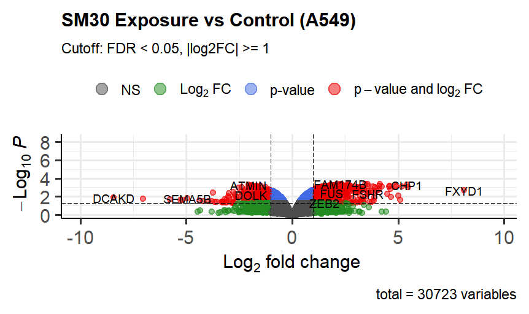
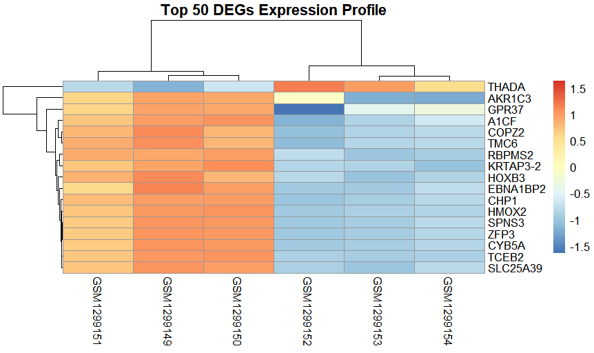
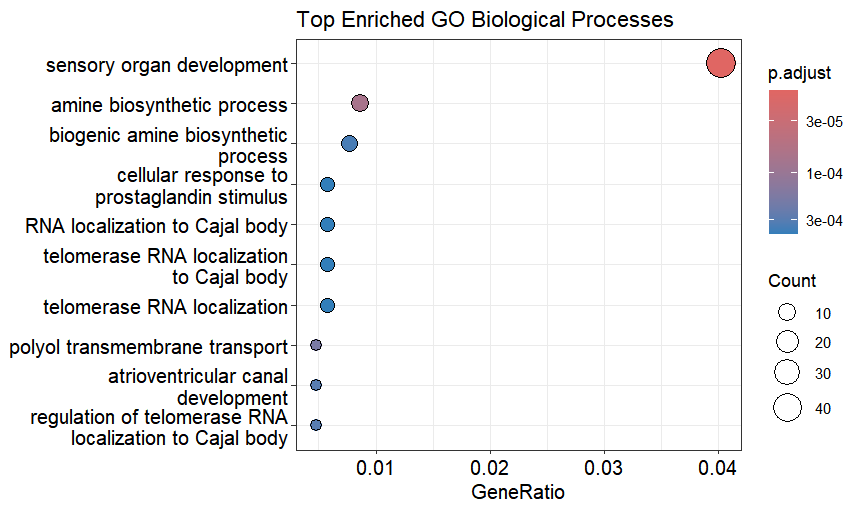

# Transcriptomic Profiling of Nanoparticle Exposure in A549 Lung Adenocarcinoma

An end-to-end computational pipeline evaluating the molecular consequences of SM30 amorphous silica nanoparticle treatment on A549 lung cancer cells using public microarray data (NCBI GEO: GSE53700).

---

## 🔬 Methodology Summary
* **Differential Gene Expression:** Implemented empirical Bayes linear modeling via `limma` comparing SM30-treated cells against untreated controls.
* **Statistical Thresholds:** Statistically significant genes filtered at adj. p value < 0.05 and log2FC > 1 or < -1.
* **Functional Annotation:** Evaluated pathway activation and suppression using `clusterProfiler` across KEGG and Gene Ontology (GO Biological Process).
* **Clinical Translation:** Downstream candidate genes mapped against TCGA lung adenocarcinoma cohorts for overall survival associations.

---

## 📊 Results & Visualizations

### 1. Differential Expression Profile (Volcano Plot)

### 2. Top 50 DEGs Hierarchical Clustering

### 3. Pathway Enrichment Analysis

---

## 📂 Repository Structure
* `transcriptomics_analysis.R`: Full executable R/Bioconductor pipeline.
* `significant_degs_SM30.csv`: Screened statistically significant differentially expressed genes.
* `volcano_plot.png`, `heatmap.png`, `go_enriched_dotplot.png`: High-resolution figures generated by the pipeline.
